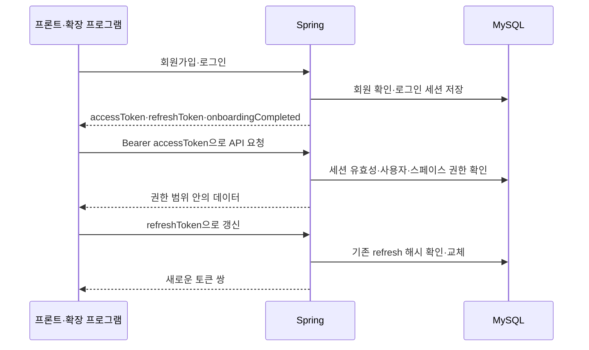
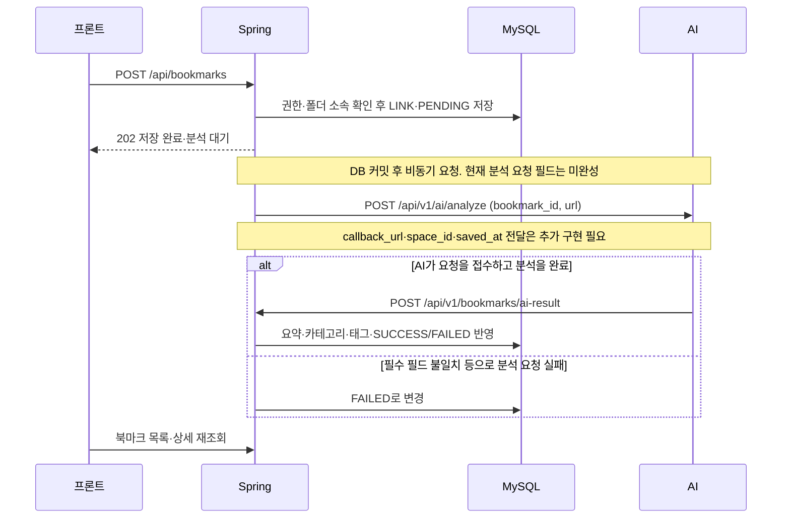

# SSok 백엔드 API 명세서

> 📌 **프론트·Spring·AI 연결 명세** (담당: 백엔드 팀)
>
> 기준일: **2026-11-23**. 서버 저장소의 **`feat/onboarding-account` 현재 로컬 코드(미커밋 변경 포함)** 기준입니다.
> `develop`·운영 배포 반영 여부를 뜻하지 않습니다. 코드·테스트로 확인된 계약과 협의·연동 대기 사항을 구분합니다.
>
> 구성은 공유받은 [AI API 명세](https://app.notion.com/p/AI-API-3ea6f13325d9807d9002d4060ee577ff)의 전체 흐름·협의 사항·표·검증 항목 형식을 참고했습니다.
> 업무 API는 **48개 동작, 호환 경로를 포함한 49개 HTTP 경로 조합**입니다. 아래 API 번호와 상세 번호를 함께 확인합니다.

## 1. 전체 흐름

### 1-1. 로그인·권한·조회



### 1-2. 링크 북마크 저장·분석



202는 **MySQL 저장 및 비동기 작업 요청**의 의미입니다. 실제 AI 접수·완료를 보장하지 않습니다.
AI 요청 실패를 감지하면 FAILED로 변경합니다. 상태가 바뀌지 않는 장기 PENDING의 자동 시간 초과 처리는 미구현입니다.

### 1-3. 초대·파일·삭제

- 초대: OWNER 발급 → 수신 이메일로 로그인 → 이메일 링크의 토큰으로 수락 → 멤버십 생성.
- 파일: 인증·공간 권한 확인 → 형식·10 MiB 제한 확인 → 로컬 저장 → 파일 메타데이터 저장.
- 파일 북마크: FILE·NOT_SUPPORTED로 저장. 파일 분석·대화 AI 전달은 아직 연결하지 않습니다.
- 라이브러리 삭제: 폴더 연결만 해제하고 북마크·파일·태그·분석 결과를 보존합니다.
- 파일·북마크·스페이스 삭제: DB 커밋 후 물리 파일 삭제. 실패·중단 작업은 DB에 남겨 재시도합니다.
- 계정 삭제: 비밀번호 재확인 → 팀 소유권 차단 검사 → 개인 공간·개인 첨부·계정 데이터 삭제 → 개인 공간 벡터 정리 작업 예약.

## 2. 확정 정책과 공통 규칙

### 2-1. 주소·인증·본문

| 항목 | 현재 계약 |
|---|---|
| 로컬 Base URL | `http://localhost:8080` |
| 운영 Base URL | 배포 후 공유. 이 문서에서 임의의 운영 주소를 정하지 않음 |
| Swagger | `/swagger-ui/index.html` |
| 실행 서버의 OpenAPI | `/v3/api-docs` |
| 일반 본문 | `Content-Type: application/json` |
| 파일 업로드 | `multipart/form-data`; boundary는 HTTP 클라이언트가 설정 |
| 보호 API | `Authorization: Bearer {accessToken}` |
| 공개 인증 API | 회원가입·로그인·refresh. logout은 access token 필요 |
| AI 콜백 | 사용자 JWT 대신 조건부 `X-AI-Callback-Secret` 검사 |
| JSON 이름 | 프론트용 camelCase; AI 요청·콜백 DTO는 snake_case |

Swagger Authorize에는 토큰 값만 입력합니다. 일반 HTTP 요청에는 `Bearer ` 접두사를 포함합니다.
사용자·역할은 요청 본문의 userId가 아니라 인증 및 DB에서 판정합니다.

### 2-2. 공통 응답

파일 다운로드를 제외한 Spring 업무 API는 다음 형태입니다.

```json
{
  "status": 200,
  "success": true,
  "message": "user retrieved",
  "data": {"userId": 1, "email": "user@example.com", "name": "사용자", "profileImage": null, "onboardingCompleted": false}
}
```

```json
{
  "status": 403,
  "success": false,
  "message": "space access denied"
}
```

- `status`는 HTTP 상태 코드, `success`는 성공 여부입니다.
- 루트 `data`가 null이면 **필드 자체가 생략**됩니다. 오류 응답과 AI 콜백 성공이 해당합니다.
- DTO 내부 nullable 필드는 별도 명시가 없으면 JSON null로 반환됩니다.
- `message`는 사람이 읽는 설명입니다. 클라이언트 분기는 상태 코드·필드·상태 enum을 우선 사용합니다.
- **4절의 응답 예시는 `data` 부분**을 뜻합니다. 전체 HTTP 응답에는 위 래퍼가 붙습니다.

### 2-3. 식별자·시각·페이지

| 항목 | 형식·주의 |
|---|---|
| 모든 리소스 ID | Java Long, JSON integer(int64). path의 `{...Id}`는 필수 |
| userId | 사용자 계정 ID |
| memberId | **멤버십 ID**. 역할 변경·제거·소유권 이전에 사용하며 userId와 다름 |
| invitationId | 초대 기록 ID. 수락 토큰과 다름 |
| fileId | 파일 메타데이터 ID. 저장 경로·객체 키와 다름 |
| 북마크·스페이스·프로필 시각 | `TimeFormatter`를 거친 값은 `2026-11-23T12:00:00`처럼 오프셋 없는 초 단위 문자열 |
| 라이브러리 createdAt | LocalDateTime ISO 형식, 오프셋 없음. 소수 초가 포함될 수 있음 |
| 초대·파일·알림·설문 시각 | Instant ISO 형식, 예: `2026-11-23T03:00:00Z` |
| 기본 페이지 | page=0, size=20. page는 0부터 시작 |
| 북마크·라이브러리 북마크·알림 | page≥0, size=1~100을 서비스에서 검사 |
| 태그 북마크 | 기본 0/20. 별도 최대 크기 검증 없음. 잘못된 숫자 범위의 오류 정규화는 보완 필요(5절) |

**모든 시간 값이 오프셋을 포함하도록 통일된 상태가 아닙니다.** 프론트가 임의로 UTC로 간주하면 안 됩니다.
AI에 보낼 최초 saved_at의 오프셋 포함 규격은 실제 분석 요청 구현과 함께 맞춰야 합니다.

### 2-4. 스페이스 역할

| 기능 | OWNER | EDITOR | VIEWER |
|---|---|---|---|
| 참여 공간·라이브러리·북마크 조회 | 가능 | 가능 | 가능 |
| 라이브러리 생성·수정·삭제 | 가능 | 가능 | 불가 |
| 북마크 저장·삭제·폴더 이동 | 가능 | 가능 | 불가 |
| 다른 저장자의 팀 자료 삭제 | 가능 | 가능 | 불가 |
| 의미 검색·재분석·추천·태그 검색 | 가능 | 가능 | 불가 |
| 라이브러리 이름 검색 | 가능 | 가능 | 불가 |
| 팀원 목록 | 가능 | 가능 | 불가 |
| 초대·팀원 제거·역할 변경·소유권 이전 | 가능 | 불가 | 불가 |
| TEAM 직접 탈퇴 | 소유권 이전 후 | 가능 | 가능 |
| 스페이스 삭제 | 가능 | 불가 | 불가 |
| 파일 북마크 다운로드 | 가능 | 가능 | 가능 |
| 대화 첨부 | 본인 업로드 건만 | 본인 업로드 건만 | 불가 |

- 역할은 **스페이스별**입니다. 다른 공간의 OWNER라는 이유로 접근할 수 없습니다.
- MEMBER 역할은 EDITOR로 전환합니다. 클래스 SpaceMember·`/members`·memberId 명칭은 유지합니다.
- PERSONAL도 라이브러리를 사용할 수 있지만 초대·직접 탈퇴·소유권 이전은 불가합니다. 소유자의 공간 삭제는 가능합니다.
- VIEWER도 자신의 내 정보·설문·알림·인증·계정 기능은 사용합니다. 역할은 공간 자료 권한의 구분입니다.

### 2-5. 상태 값

| 구분 | 값 | 의미 |
|---|---|---|
| BookmarkType | LINK / FILE | 웹 링크 / 업로드 파일 |
| AnalysisStatus | PENDING / SUCCESS / FAILED / NOT_SUPPORTED | 분석 대기·진행 / 완료 / 실패 / 파일 분석 미지원 |
| SpaceType | PERSONAL / TEAM | 개인 / 팀 공간 |
| 초대 상태 | PENDING / ACCEPTED / CANCELLED / EXPIRED | EXPIRED는 만료 시각으로 계산하는 응답 상태 |
| 초대 delivery | PENDING / SENT / FAILED | 별도 메일 발송 상태. SENT는 SMTP 접수이며 받은편지함 도착 보장 아님 |
| FilePurpose | BOOKMARK / CHAT_ATTACHMENT | 공유 가능한 파일 북마크 / 업로더 개인 대화 첨부 |

AI 문서의 PROCESSING과 Spring의 PENDING은 같은 문자열이 아닙니다. Spring 화면 상태는 위 enum을 사용합니다.

## 3. API 전체 목록

`JWT`는 유효한 DB 로그인 세션에 연결된 access token을 뜻합니다. 공통 오류는 5-1절, 개별 오류는 4절을 함께 확인합니다.

### 3-1. 인증·계정·온보딩

| 번호 | 기능 | Method | Path | 인증 | 성공 | data |
|---|---|---|---|---|---|---|
| A01 | 회원가입 | POST | `/api/auth/register` | 없음 | 201 | RegisterResponse |
| A02 | 로그인 | POST | `/api/auth/login` | 없음 | 200 | LoginResponse |
| A03 | 토큰 갱신 | POST | `/api/auth/refresh` | refresh 본문 | 200 | Tokens |
| A04 | 현재 세션 로그아웃 | POST | `/api/auth/logout` | JWT | 200 | true |
| U01 | 내 정보 | GET | `/api/users/me` | JWT | 200 | UserMeResponse |
| U02 | 프로필 수정 | PUT | `/api/users/profile` | JWT | 200 | ProfileUpdateResponse |
| U03 | 설문 상태 조회 | GET | `/api/users/me/onboarding` | JWT | 200 | OnboardingResponse |
| U04 | 설문 제출·수정 | PUT | `/api/users/me/onboarding` | JWT | 200 | OnboardingResponse |
| U05 | 계정 삭제 | DELETE | `/api/users/me` | JWT·비밀번호 | 200 | AccountDeleteResponse |

### 3-2. 스페이스·팀원

| 번호 | 기능 | Method | Path | 권한 | 성공 | data |
|---|---|---|---|---|---|---|
| S01 | 생성 | POST | `/api/spaces` | 로그인 사용자 | 201 | SpaceCreateResponse |
| S02 | 참여 목록 | GET | `/api/spaces` | 본인 | 200 | SpaceSummaryDto[] |
| S03 | 상세 | GET | `/api/spaces/{spaceId}` | 참여 역할 전체 | 200 | SpaceDetailResponse |
| S04 | 삭제 | DELETE | `/api/spaces/{spaceId}` | OWNER | 200 | true |
| M01 | 팀원 목록 | GET | `/api/spaces/{spaceId}/members` | OWNER·EDITOR | 200 | MemberDto[] |
| M02 | 팀원 제거 | DELETE | `/api/spaces/{spaceId}/members/{memberId}` | OWNER | 200 | true |
| M03 | 역할 변경 | PATCH | `/api/spaces/{spaceId}/members/{memberId}/role` | OWNER | 200 | MemberDto |
| M04 | 직접 탈퇴 | DELETE | `/api/spaces/{spaceId}/members/me` | TEAM의 EDITOR·VIEWER | 200 | true |
| M05 | 소유권 이전 | PATCH | `/api/spaces/{spaceId}/owner` | TEAM의 OWNER | 200 | 신규 OWNER MemberDto |

### 3-3. 초대

| 번호 | 기능 | Method | Path | 권한 | 성공 | data |
|---|---|---|---|---|---|---|
| I01 | 발급 | POST | `/api/spaces/{spaceId}/invitations` | TEAM OWNER | 201 | InvitationResponse |
| I01-A | 발급 호환 경로 | POST | `/api/spaces/{spaceId}/invite` | I01과 동일 | 201 | InvitationResponse |
| I02 | 목록 | GET | `/api/spaces/{spaceId}/invitations` | OWNER | 200 | InvitationResponse[] |
| I03 | 취소 | DELETE | `/api/spaces/{spaceId}/invitations/{invitationId}` | OWNER | 200 | true |
| I04 | 재발급·재발송 | POST | `/api/spaces/{spaceId}/invitations/{invitationId}/resend` | OWNER | 200 | InvitationResponse |
| I05 | 수락 | POST | `/api/spaces/invitations/accept` | 수신 이메일의 로그인 사용자 | 200 | MemberDto |

### 3-4. 라이브러리·북마크

| 번호 | 기능 | Method | Path | 권한 | 성공 | data |
|---|---|---|---|---|---|---|
| L01 | 폴더 생성 | POST | `/api/spaces/{spaceId}/libraries` | OWNER·EDITOR | 201 | LibraryResponse |
| L02 | 목록·이름 검색 | GET | `/api/spaces/{spaceId}/libraries` | 목록: 전체, 검색: OWNER·EDITOR | 200 | LibraryResponse[] |
| L03 | 상세 | GET | `/api/spaces/{spaceId}/libraries/{libraryId}` | 참여 역할 전체 | 200 | LibraryResponse |
| L04 | 이름 변경 | PATCH | `/api/spaces/{spaceId}/libraries/{libraryId}` | OWNER·EDITOR | 200 | LibraryResponse |
| L05 | 삭제 | DELETE | `/api/spaces/{spaceId}/libraries/{libraryId}` | OWNER·EDITOR | 200 | true |
| L06 | 폴더 북마크 목록 | GET | `/api/spaces/{spaceId}/libraries/{libraryId}/bookmarks` | 참여 역할 전체 | 200 | BookmarkListResponse |
| B01 | 링크 저장 | POST | `/api/bookmarks` | 해당 공간 OWNER·EDITOR | 202 | BookmarkSaveResponse |
| B02 | 목록·폴더 필터 | GET | `/api/bookmarks` | 참여 역할 전체 | 200 | BookmarkListResponse |
| B03 | 상세·방문 기록 | GET | `/api/bookmarks/{bookmarkId}` | 참여 역할 전체 | 200 | BookmarkDetailResponse |
| B04 | 삭제 | DELETE | `/api/bookmarks/{bookmarkId}` | OWNER·EDITOR | 200 | true |
| B05 | 폴더 이동·미분류 | PATCH | `/api/bookmarks/{bookmarkId}/library` | OWNER·EDITOR | 200 | BookmarkSummaryDto |

### 3-5. 파일·알림

| 번호 | 기능 | Method | Path | 권한 | 성공 | data |
|---|---|---|---|---|---|---|
| F01 | 업로드 | POST | `/api/files` | OWNER·EDITOR | 201 | FileResponse |
| F02 | 메타데이터 | GET | `/api/files/{fileId}` | 용도별 권한 | 200 | FileResponse |
| F03 | 다운로드 | GET | `/api/files/{fileId}/download` | 용도별 권한 | 200 | **바이너리** |
| F04 | 삭제 | DELETE | `/api/files/{fileId}` | 용도별 권한 | 200 | true |
| N01 | 내 알림 목록 | GET | `/api/notifications` | 본인 | 200 | NotificationListResponse |
| N02 | 미읽음 개수 | GET | `/api/notifications/unread-count` | 본인 | 200 | {unreadCount} |
| N03 | 개별 읽음 | PATCH | `/api/notifications/{notificationId}/read` | 수신자 본인 | 200 | true |
| N04 | 전체 읽음 | PATCH | `/api/notifications/read-all` | 본인 | 200 | {updatedCount} |

### 3-6. 태그·AI·콜백

| 번호 | 기능 | Method | Path | 권한 | 성공 | data |
|---|---|---|---|---|---|---|
| T01 | 태그 목록 | GET | `/api/tags` | 허용된 OWNER·EDITOR 공간 | 200 | TagDto[] |
| T02 | 태그의 북마크 | GET | `/api/tags/{tagName}/bookmarks` | 허용된 OWNER·EDITOR 공간 | 200 | TagBookmarkListResponse |
| AI01 | 링크 재분석 | POST | `/api/ai/summary` | OWNER·EDITOR | 202 | SummaryResponse |
| AI02 | 의미 검색 | POST | `/api/ai/search` | 허용된 OWNER·EDITOR 공간 | 200 | SimilarBookmarkResponse[] |
| AI03 | 유사 링크 추천 | GET | `/api/ai/recommend` | 대상 공간 OWNER·EDITOR | 200 | SimilarBookmarkResponse[] |
| C01 | AI 결과 수신 | POST | `/api/v1/bookmarks/ai-result` | AI 콜백 시크릿 | 200 | 없음 |

## 4. API별 상세

### A01. 회원가입

`POST /api/auth/register` — JWT 불필요, JSON.

| 필드 | 타입 | 필수 | 검사 |
|---|---|---|---|
| email | string | Y | 비어 있지 않은 이메일 |
| password | string | Y | 비어 있지 않음 |
| name | string | Y | 비어 있지 않음 |

```json
{"email":"user@example.com","password":"sample-password","name":"사용자"}
```

201 data: `{"userId":1,"email":"user@example.com"}`.
400: 필수 값·이메일 형식 오류. 409: 중복 이메일.
이 API가 개인 스페이스나 설문 완료 상태를 자동 생성하지는 않습니다. 비밀번호 길이 정책을 DTO에 없는 규칙으로 가정하지 않습니다.

### A02. 로그인

`POST /api/auth/login` — JWT 불필요.

본문: `{"email":"user@example.com","password":"sample-password"}`. 두 값 모두 필수·비어 있지 않아야 합니다.

```json
{"accessToken":"<access-token>","refreshToken":"<refresh-token>","userId":1,"nickname":"사용자","onboardingCompleted":false}
```

200: 새 로그인 세션 발급. 400: 누락·빈 값. 401: 없는 이메일 또는 비밀번호 불일치.
성공 시 lastLoginAt 갱신, 필요 시 복귀 알림 생성. 다른 세션은 유지합니다.

### A03. 토큰 갱신

`POST /api/auth/refresh` — access JWT 불필요, refresh token으로 검증.

본문: `{"refreshToken":"<refresh-token>"}`. 필수, 최대 4096자.
200 data: `{"accessToken":"<new-access>","refreshToken":"<new-refresh>"}`.
400: 빈 값·길이 오류. 401: 만료·잘못된 종류·없는/폐기된 세션·사용한 refresh.

- 같은 refresh의 동시 갱신은 하나만 성공합니다. 새 refresh는 다시 14일 기본 만료를 갖습니다.
- 기존 access는 자신의 만료까지 유지됩니다. 세션 로그아웃 시에는 모두 차단됩니다.
- 재사용한 refresh의 실패가 다른 기기 세션까지 폐기하지는 않습니다.
- 프론트는 같은 세션의 갱신을 한 번씩 실행하고 두 토큰을 함께 교체합니다.

### A04. 현재 세션 로그아웃

`POST /api/auth/logout` — JWT 필수, 본문 없음.
200 data: true. 401: 유효한 access·세션 없음.
현재 sid의 access·refresh를 차단합니다. 다른 로그인은 유지합니다. 폐기한 토큰으로 다시 요청하면 401입니다.

### U01. 내 정보

`GET /api/users/me` — JWT 필수, 본문 없음.

```json
{"userId":1,"email":"user@example.com","name":"사용자","profileImage":null,"onboardingCompleted":false}
```

200. 비밀번호·refresh 해시·세션 목록은 반환하지 않습니다. 삭제된 계정·무효 세션은 401입니다.

### U02. 프로필 수정

`PUT /api/users/profile` — 본인 JWT.

| 필드 | 타입 | 필수 | 검사·동작 |
|---|---|---|---|
| name | string | Y | 비어 있지 않음, 최대 100자, 앞뒤 공백 제거 |
| profileImage | string/null | N | URL, 최대 1000자. null/생략하면 기존 이미지 제거 |

본문 예: `{"name":"새 이름","profileImage":null}`.
200 data: `{"userId":1,"nickname":"새 이름","updatedAt":"2026-11-23T12:00:00"}`.
400: 잘못된 프로필 정보. 이메일·비밀번호 변경 API가 아닙니다.

### U03. 설문 상태 조회

`GET /api/users/me/onboarding` — 본인 JWT.
200 data: `{"completed":false,"purposes":[],"completedAt":null}`.
완료한 경우 purposes는 아래 ID 배열, completedAt은 Instant 문자열입니다.

### U04. 설문 제출·수정

`PUT /api/users/me/onboarding` — 본인 JWT.

본문: `{"purposes":["reference","team-share"]}`.

| ID | 의미 |
|---|---|
| reference | 프로젝트·기획 레퍼런스 수집 |
| archive | 기술 아티클·논문·문서 아카이빙 |
| team-share | 팀 자료 공유 |
| personal | 개인 취향·취미 |
| etc | 기타 |

purposes는 필수, 원소 1~5개, null 원소·알 수 없는 ID는 400입니다. 중복은 제거합니다.
200 data: `{"completed":true,"purposes":["reference","team-share"],"completedAt":"2026-11-23T03:00:00Z"}`.
최초 완료 시각은 수정해도 유지합니다. 완료 상태로 기존 자료 API를 강제 차단하지 않습니다.

### U05. 계정 삭제

`DELETE /api/users/me` — 본인 JWT·JSON 비밀번호 재확인.

본문: `{"password":"sample-password"}`. 필수·비어 있지 않음, 최대 200자.
200 data: `{"accountDeleted":true,"vectorCleanupTaskCount":1}`.
400: 잘못된 본문. 401: 비밀번호 불일치·무효 인증. 409: TEAM 소유권이 남음, 또는 삭제 중 참여 범위가 바뀌어 재시도 필요.

- TEAM 소유자는 먼저 소유권 이전 또는 공간 삭제를 해야 합니다.
- PERSONAL 공간·개인 대화 첨부·설문·수신 알림·모든 세션을 삭제합니다.
- 참여 팀은 탈퇴하며 공유 자료는 유지합니다. 공유 파일의 uploaderId는 null로 익명화합니다.
- 자신을 수신자로 한 초대 이메일을 익명화하고 대기 초대를 취소합니다.
- `vectorCleanupTaskCount`는 **예약 건수**이며 AI 삭제 완료 건수가 아닙니다.
- 클라이언트도 삭제한 계정의 토큰·개인정보 캐시를 제거합니다.

### S01. 스페이스 생성

`POST /api/spaces` — JWT.
본문: `{"spaceName":"팀 프로젝트","description":"자료 모음","type":"TEAM"}`.
spaceName·type 필수·비어 있지 않음, description은 선택 문자열/null. type은 PERSONAL 또는 TEAM.
201 data: `{"spaceId":8,"spaceName":"팀 프로젝트","description":"자료 모음","type":"TEAM"}`.
생성자는 OWNER 멤버십을 갖습니다. 400: 잘못된 본문·유형.

### S02. 참여 스페이스 목록

`GET /api/spaces` — JWT, 본문 없음.
200 data: `[{"spaceId":8,"spaceName":"팀 프로젝트","type":"TEAM","bookmarkCount":3}]`.
본인의 OWNER·EDITOR·VIEWER 멤버십만 반환하며, 없으면 []입니다.
개수는 미분류·폴더·FILE을 포함한 해당 공간의 전체 북마크 수입니다.

### S03. 스페이스 상세

`GET /api/spaces/{spaceId}` — 해당 공간의 모든 참여 역할.

```json
{"spaceId":8,"spaceName":"팀 프로젝트","description":"자료 모음","type":"TEAM","ownerId":1,"memberCount":3,"bookmarkCount":3,"createdAt":"2026-11-23T12:00:00"}
```

403: 비멤버. 404: 없는 공간. 응답에는 본인의 role 필드가 별도로 포함되지 않습니다.

### S04. 스페이스 삭제

`DELETE /api/spaces/{spaceId}` — OWNER, 본문 없음.
200 data: true. 403: 비소유자. 404: 없는 공간.
북마크·태그·폴더·멤버십·초대·파일 메타데이터를 삭제하고 물리 파일 정리를 예약합니다.
일반 공간 삭제의 AI 벡터 동기화는 아직 연결되지 않았습니다. U05의 개인 공간 정리와 구분합니다.

### M01. 팀원 목록

`GET /api/spaces/{spaceId}/members` — OWNER·EDITOR.
200 data: `[{"memberId":11,"userId":1,"nickname":"사용자","email":"user@example.com","role":"OWNER"}]`.
VIEWER·비멤버 403, 없는 공간 404. 개인 공간 OWNER도 자신의 멤버십을 조회할 수 있습니다.

### M02. 팀원 제거

`DELETE /api/spaces/{spaceId}/members/{memberId}` — OWNER, 본문 없음.
200 data: true. 403: 비소유자·OWNER 대상. 404: 없는 공간·해당 공간에 없는 memberId.
팀에 저장된 자료는 남기고 접근 권한을 제거합니다. 대상에게 앱 내 알림을 생성합니다.

### M03. 팀원 역할 변경

`PATCH /api/spaces/{spaceId}/members/{memberId}/role` — OWNER.
본문: `{"role":"VIEWER"}`. role 필수, EDITOR 또는 VIEWER만 허용.
200 data: 변경된 MemberDto.
400: null·MEMBER·OWNER 지정 등 잘못된 역할. 403: 비소유자·기존 OWNER 대상. 404: 없는 대상.
같은 역할로 요청하면 성공하지만 새 역할 변경 알림은 생성하지 않습니다.

### M04. 직접 탈퇴

`DELETE /api/spaces/{spaceId}/members/me` — TEAM의 EDITOR·VIEWER.
200 data: true. 403: OWNER의 직접 탈퇴·PERSONAL·비멤버. 404: 없는 공간.
저장한 팀 자료는 유지하며 OWNER에게 탈퇴 알림을 생성합니다. OWNER는 M05 후 탈퇴합니다.

### M05. 소유권 이전

`PATCH /api/spaces/{spaceId}/owner` — TEAM OWNER.
본문: `{"memberId":12}`. memberId 필수·양수.
200 data: 새 OWNER의 MemberDto. 이전 OWNER는 EDITOR가 됩니다.
400: 자기 자신·잘못된 ID. 403: 비소유자·PERSONAL. 404: 같은 공간에 없는 대상.
기존 팀원 EDITOR·VIEWER만 대상으로 하며 신규 OWNER에게 알림을 생성합니다.

### I01 / I01-A. 초대 발급

`POST /api/spaces/{spaceId}/invitations`, 호환 `POST /api/spaces/{spaceId}/invite`.
TEAM OWNER 전용. **호환 경로도 즉시 멤버를 등록하지 않습니다.**

본문: `{"email":"member@example.com","role":"EDITOR"}`.
email은 필수 이메일, role은 선택이며 기본 EDITOR. VIEWER도 가능하고 OWNER는 400입니다.

```json
{"invitationId":21,"spaceId":8,"email":"member@example.com","role":"EDITOR","status":"PENDING","delivery":"PENDING","expiresAt":"2026-11-26T03:00:00Z","invitationUrl":"http://localhost:3000/invitations/accept#token=<invitation-token>"}
```

201. 403: 비소유자·PERSONAL. 404: 공간 없음. 409: 이미 멤버·같은 이메일의 유효한 대기 초대.
가입 전 이메일도 발급 가능합니다. 기본 유효기간은 72시간이며 운영 정책은 회의 확정 대상입니다.
응답은 커밋 전에 만들어져 delivery=PENDING일 수 있습니다. 실제 발송 결과는 목록에서 확인합니다.

### I02. 초대 목록

`GET /api/spaces/{spaceId}/invitations` — OWNER.
200 data: InvitationResponse[]; ID 내림차순. 목록의 invitationUrl은 null입니다.
상태가 PENDING이고 시각이 지났으면 EXPIRED로 표시합니다. 403: 비소유자. 404: 없는 공간.

### I03. 초대 취소

`DELETE /api/spaces/{spaceId}/invitations/{invitationId}` — OWNER.
200 data: true. 반복 취소도 성공합니다.
403: 비소유자. 404: 해당 공간에 없는 초대. 409: 이미 ACCEPTED(팀원 제거 API 사용).

### I04. 초대 재발급·재발송

`POST /api/spaces/{spaceId}/invitations/{invitationId}/resend` — OWNER, 본문 없음.
200 data: **새 토큰 URL**이 포함된 InvitationResponse.
PENDING만 가능하며 만료 건도 재발급할 수 있습니다. 기존 링크는 즉시 무효화됩니다.
403: 비소유자. 404: 없는 초대. 409: ACCEPTED·CANCELLED·같은 이메일의 다른 유효 초대 존재.

### I05. 초대 수락

`POST /api/spaces/invitations/accept` — 수신 이메일로 로그인.
본문: `{"token":"<invitation-token>"}`. 필수·비어 있지 않음·최대 128자.
200 data: 새 MemberDto. role은 초대 발급 시 저장한 역할입니다.
403: 다른 이메일. 404: 잘못된/재발급 전 토큰·없는 대상. 409: 만료·취소·중복 수락·이미 멤버.
토큰 없는 invitationId만으로 수락할 수 없습니다. 링크 GET 요청으로도 멤버십이 생기지 않습니다.

### L01. 라이브러리 생성

`POST /api/spaces/{spaceId}/libraries` — OWNER·EDITOR.
본문: `{"name":"UX/UI 스터디"}`. 필수·비어 있지 않음·최대 100자.
201 data: LibraryResponse.
이름 앞뒤 공백을 제거하고 같은 공간의 정규화 이름 중복은 409입니다. 다른 공간은 같은 이름 가능.
403: 쓰기 권한 없음. 404: 없는 공간. 하위 폴더나 parentId 모델은 제공하지 않습니다.

### L02. 라이브러리 목록·이름 검색

`GET /api/spaces/{spaceId}/libraries?query=UX`.
query 선택 문자열. 생략·공백이면 전체 참여 역할이 목록 조회 가능, 실제 검색어가 있으면 OWNER·EDITOR만 가능.

```json
[{"libraryId":31,"spaceId":8,"name":"UX/UI 스터디","bookmarkCount":2,"createdAt":"2026-11-23T12:00:00"}]
```

200, ID 오름차순. query는 대소문자를 구분하지 않는 부분 검색. 403: 권한 없음. 404: 공간 없음.
bookmarkCount는 해당 폴더에 직접 연결된 북마크 수입니다.

### L03. 라이브러리 상세

`GET /api/spaces/{spaceId}/libraries/{libraryId}` — 참여 역할 전체.
200 data: LibraryResponse(위 배열의 원소). 403: 비멤버. 404: 공간·해당 공간에 없는 폴더.

### L04. 라이브러리 이름 변경

`PATCH /api/spaces/{spaceId}/libraries/{libraryId}` — OWNER·EDITOR.
본문은 L01과 동일. 200 data: LibraryResponse.
400: 이름 형식. 403: 권한 없음. 404: 없는 폴더. 409: 같은 공간의 중복 이름.

### L05. 라이브러리 삭제

`DELETE /api/spaces/{spaceId}/libraries/{libraryId}` — OWNER·EDITOR.
200 data: true. 403: 권한 없음. 404: 없는 폴더.
북마크를 미분류로 전환합니다. 최초 저장 시각·요약·태그·FILE 원본과 AI 벡터는 유지합니다.

### L06. 폴더 북마크 목록

`GET /api/spaces/{spaceId}/libraries/{libraryId}/bookmarks` — 참여 역할 전체.
query: page=0, size=20, sort=recent. sort는 recent / oldest / title, 동률은 ID로 정렬합니다.
200 data: B02의 BookmarkListResponse. 빈 폴더는 content=[]·totalElements=0.
400: 잘못된 페이지·크기·정렬. 403: 비멤버. 404: 폴더 없음.

### B01. 링크 북마크 저장

`POST /api/bookmarks` — OWNER·EDITOR.

| 필드 | 타입 | 필수 | 검사 |
|---|---|---|---|
| url | string | Y | 비어 있지 않은 URL |
| spaceId | integer(int64) | Y | 존재·쓰기 권한 |
| libraryId | integer(int64)/null | N | 양수, 같은 공간의 폴더. null/생략은 미분류 |

본문: `{"url":"https://spring.io","spaceId":8,"libraryId":31}`.
202 data: `{"bookmarkId":41,"title":"spring.io","analysisStatus":"PENDING","createdAt":"2026-11-23T12:00:00"}`.
초기 제목은 URL 호스트를 사용합니다. AI 요청은 커밋 후 별도 실행됩니다.
400: 잘못된 입력. 403: 권한 없음. 404: 공간·같은 공간의 폴더 없음.

### B02. 북마크 목록·폴더 필터

`GET /api/bookmarks?spaceId=8&page=0&size=20` — 참여 역할 전체.

| query | 필수 | 기본·의미 |
|---|---|---|
| spaceId | Y | 대상 공간 |
| page | N | 0 |
| size | N | 20, 1~100 |
| libraryId | N | 해당 폴더만 |
| unclassified | N | false; true면 미분류만 |

```json
{"content":[{"bookmarkId":41,"title":"spring.io","summary":null,"visitCount":0,"lastVisitedAt":null,"category":null,"analysisStatus":"PENDING","tags":[],"libraryId":31,"type":"LINK","fileId":null}],"page":0,"size":20,"totalElements":1,"totalPages":1}
```

최근 저장 순·동률 ID 내림차순. 전체 조회는 FILE도 포함합니다.
400: 페이지 오류, libraryId와 unclassified=true 동시 지정. 403: 비멤버. 404: 공간·폴더 없음.
반환된 content 원소가 BookmarkSummaryDto입니다. **요약 목록에는 url·createdAt·저장자 이름 필드가 없습니다.**

### B03. 북마크 상세·방문 기록

`GET /api/bookmarks/{bookmarkId}` — 해당 공간 참여 역할 전체.

```json
{"bookmarkId":41,"title":"spring.io","url":"https://spring.io","summary":"예시 요약","visitCount":1,"createdAt":"2026-11-23T12:00:00","lastVisitedAt":"2026-11-23T12:05:00","category":"개발","analysisStatus":"SUCCESS","tags":["Spring"],"libraryId":31,"type":"LINK","fileId":null}
```

200. **권한 확인 후 visitCount·lastVisitedAt을 갱신하는 조회**입니다.
403: 비멤버. 404: 북마크 없음. FILE의 url은 인증 다운로드 상대 경로이고 fileId가 존재합니다.

### B04. 북마크 삭제

`DELETE /api/bookmarks/{bookmarkId}` — OWNER·EDITOR, 다른 저장자의 자료도 가능.
200 data: true. 403: 권한 없음. 404: 없는 북마크.
태그·FILE 메타데이터도 삭제하고 물리 파일 정리를 예약합니다.
일반 링크 북마크의 AI 벡터 삭제 연결은 아직 미완료입니다.

### B05. 폴더 이동·미분류 전환

`PATCH /api/bookmarks/{bookmarkId}/library` — OWNER·EDITOR.
본문: `{"libraryId":31}` 또는 `{"libraryId":null}`.
필드 자체는 필수. 정수 값은 양수, null은 미분류입니다.
200 data: BookmarkSummaryDto. 400: 필드 누락·잘못된 값. 403: 권한 없음. 404: 북마크·같은 공간의 폴더 없음.
spaceId·최초 저장 시각을 바꾸지 않습니다. 다른 스페이스로 이동·다중 이동은 이 API에 없습니다.

### F01. 파일 업로드

`POST /api/files` — OWNER·EDITOR, **multipart/form-data**.

| part/field | 타입 | 필수 | 의미 |
|---|---|---|---|
| file | binary | Y | PDF·PNG·JPEG, 0바이트 불가, 최대 10 MiB |
| spaceId | integer(int64) | Y | 대상 공간 |
| purpose | string | N | BOOKMARK 기본 / CHAT_ATTACHMENT |
| libraryId | integer(int64) | N | BOOKMARK에만 사용, 같은 공간 폴더 |

```json
{"fileId":51,"spaceId":8,"bookmarkId":42,"libraryId":31,"uploaderId":1,"purpose":"BOOKMARK","originalName":"자료.pdf","contentType":"application/pdf","sizeBytes":1024,"createdAt":"2026-11-23T03:00:00Z","downloadUrl":"/api/files/51/download"}
```

201. BOOKMARK는 FILE·NOT_SUPPORTED 북마크를 만듭니다. CHAT_ATTACHMENT는 bookmarkId·libraryId=null입니다.
확장자와 바이트 시그니처를 검사하고 원본 이름의 경로를 제거합니다. 저장 위치·UUID 키는 반환하지 않습니다.
400: 빈 파일·잘못된 용도·CHAT의 libraryId. 403: 쓰기 권한 없음. 404: 공간·폴더 없음.
413: 10 MiB 초과, 415: 지원하지 않는 형식·시그니처 불일치, 503: 저장소 오류.
전체 multipart 요청 한도는 11 MiB입니다. 파일 형식 전체 파싱·AI 분석 완료를 의미하지 않습니다.

### F02. 파일 메타데이터

`GET /api/files/{fileId}`.
200 data: FileResponse. BOOKMARK는 현재 공간 멤버가 조회 가능하고 CHAT_ATTACHMENT는 업로더 본인이며 OWNER·EDITOR인 경우만 가능합니다.
403: 권한 없음. 404: 없는 파일. 탈퇴한 업로더의 공유 파일은 uploaderId=null입니다.

### F03. 파일 다운로드

`GET /api/files/{fileId}/download` — F02와 같은 권한. Bearer token 필수.
**200 본문은 원본 바이너리이며 공통 JSON 래퍼가 아닙니다.**

```http
Content-Type: application/pdf
Content-Disposition: attachment; ...
Content-Length: 1024
Cache-Control: no-store
X-Content-Type-Options: nosniff
```

403: 권한 없음. 404: 메타데이터 없음. 503: 저장소 경로 불일치·물리 파일 읽기 오류·크기 불일치.
downloadUrl을 공개 이미지 URL로 사용하지 않습니다. 프론트는 인증한 요청으로 파일을 받습니다.

### F04. 파일 삭제

`DELETE /api/files/{fileId}`.
BOOKMARK는 해당 공간 OWNER·EDITOR, CHAT_ATTACHMENT는 현재 OWNER·EDITOR인 업로더 본인만 가능.
200 data: true. 403: 권한 없음. 404: 파일 없음.
BOOKMARK 파일 삭제는 연결된 북마크도 삭제합니다. 물리 삭제 실패는 재시도하며 메타데이터 복구를 뜻하지 않습니다.

### N01. 내 알림 목록

`GET /api/notifications?page=0&size=20&unreadOnly=false` — 본인 JWT.

```json
{"notifications":[{"notificationId":61,"type":"MEMBER_ROLE_CHANGED","message":"스페이스에서 내 역할이 변경되었습니다.","createdAt":"2026-11-23T03:00:00Z","readAt":null,"target":{"kind":"SPACE","available":true,"spaceId":8,"bookmarkId":null,"invitationId":null,"requiresInvitationToken":false}}],"page":0,"size":20,"totalElements":1,"totalPages":1}
```

200. createdAt·동률 ID 내림차순. unreadOnly=true면 readAt=null만 조회. 잘못된 페이지·크기는 400.
대상 소멸·접근 상실 시 target.kind=NONE, available=false이고 대상 ID를 null로 돌려줍니다.
알림 타입·수신 대상은 6-3절을 참고합니다. 알림 생성용 공개 POST API는 없습니다.

### N02. 내 미읽음 개수

`GET /api/notifications/unread-count` — 본인 JWT.
200 data: `{"unreadCount":3}`. 접근할 수 없어진 과거 대상의 미읽음 알림도 기록 개수에 포함합니다.

### N03. 개별 읽음

`PATCH /api/notifications/{notificationId}/read` — 수신자 본인.
200 data: true. 반복 호출해도 최초 readAt을 바꾸지 않습니다.
다른 사람의 알림·없는 알림은 동일하게 404입니다.

### N04. 전체 읽음

`PATCH /api/notifications/read-all` — 본인 JWT, 본문 없음.
200 data: `{"updatedCount":3}`. 자신의 미읽음만 변경하고, 다시 호출하면 0입니다.

### T01. 태그 목록

`GET /api/tags?spaceId=8` — JWT.
spaceId는 선택. 지정하면 그 공간의 검색 권한 검사, 생략하면 본인이 OWNER·EDITOR인 전체 공간입니다.
200 data: `[{"tagName":"Spring","bookmarkCount":3}]`. 개수 내림차순.
허용 공간이 없으면 []. 403: 지정 공간이 VIEWER·비멤버. 404: 지정 공간 없음.
코드는 태그 항목 등장 횟수를 집계합니다. 중복 태그 정규화 규칙을 이 API가 강제하지는 않습니다.

### T02. 특정 태그의 북마크

`GET /api/tags/{tagName}/bookmarks?spaceId=8&page=0&size=20`.
spaceId 범위는 T01과 동일. tagName은 path에 URL 인코딩합니다.

```json
{"tagName":"Spring","content":[],"page":1,"size":20,"totalElements":1,"totalPages":1}
```

200 data: tagName + BookmarkSummaryDto 페이지. 위 예시는 전체 결과는 있지만 요청 페이지가 범위를 넘은 경우입니다.
**전체 검색 결과가 0이면 404**입니다. 403: 지정 공간 권한 없음. 404: 공간 없음·허용 범위에 해당 태그 자료 없음.
태그 API의 잘못된 숫자 범위·크기 한도 검증은 다른 목록 API와 아직 동일하지 않습니다(5-3절).

### AI01. 링크 재분석 요청

`POST /api/ai/summary` — 대상 공간 OWNER·EDITOR.
본문: `{"bookmarkId":41}`. bookmarkId 필수.
202 data: `{"bookmarkId":41,"analysisStatus":"PENDING"}`.
400: FILE·잘못된 본문. 403: 권한 없음. 404: 북마크 없음.
요약 문자열을 동기 반환하는 API가 아닙니다. 커밋 후 AI 요청, 콜백 후 목록·상세를 재조회합니다.

### AI02. 의미 검색

`POST /api/ai/search` — JWT.
본문: `{"query":"전에 저장한 스프링 문서","spaceId":8}`.
query는 필수·공백 불가, spaceId는 선택입니다. 프론트용 topK·날짜·libraryId 필드는 없습니다.

```json
[{"bookmarkId":41,"title":"Spring 문서","url":"https://spring.io","summary":"예시 요약","similarity":0.94}]
```

200. Spring이 권한 확인한 space_ids와 고정 top_k=5를 AI에 전달합니다.
결과는 현재 허용 공간·MySQL 존재 여부로 거르고 LINK만 반환합니다. 5개보다 적거나 []일 수 있습니다.
공간 생략 시 OWNER·EDITOR 전체, 검색 가능 공간이 없으면 AI를 호출하지 않고 [].
400: 공백 검색어. 403: 지정 공간 VIEWER·비멤버. 404: 지정 공간 없음. 502: AI 호출 실패.
유사 결과 수는 전체 매칭 건수가 아닙니다.

### AI03. 유사 링크 추천

`GET /api/ai/recommend?bookmarkId=41` — 대상 공간 OWNER·EDITOR.
bookmarkId는 필수 query입니다. 200 data: SimilarBookmarkResponse[].
요약이 없으면 []. 제목+요약을 검색어로 사용해 고정 top_k=6으로 검색하고 자기 자신을 제외한 최대 5개를 구성합니다.
검색 범위는 사용자의 OWNER·EDITOR 전체 공간입니다. FILE·존재하지 않는 결과는 반환하지 않습니다.
400: FILE 추천 요청. 403: 대상 권한 없음. 404: 대상 없음. 502: AI 호출 실패.
최종 화면에서 이 기능을 계속 사용할지는 프론트·AI와 확정해야 합니다.

### C01. AI 분석 결과 콜백

`POST /api/v1/bookmarks/ai-result` — AI 서버 전용, 사용자 JWT 불필요.
헤더: `X-AI-Callback-Secret: {AI_CALLBACK_SECRET}`.
설정값이 비어 있으면 **현재 구현은 시크릿 검사를 생략**합니다. 운영에서는 값을 설정하고 AI와 맞춰야 합니다.

```json
{"bookmark_id":41,"status":"SUCCESS","analysis":{"summary":"예시 요약","category":"개발","tags":["Spring","Java"]}}
```

```json
{"bookmark_id":41,"status":"FAILED","analysis":null}
```

200 전체 응답: `{"status":200,"success":true,"message":"analysis result applied"}`.
400: bookmark_id 누락·status 공백·FILE에 성공 분석 적용. 401: 설정된 시크릿 불일치·누락. 404: 북마크가 삭제됐거나 없음.

- `status="SUCCESS"`이고 analysis가 존재할 때만 성공 처리합니다.
- 그 외 비어 있지 않은 status·SUCCESS와 analysis=null도 **현재는 FAILED 처리**합니다. 엄격한 상태 enum 검증은 없습니다.
- 제목 필드·analysis_request_id가 DTO에 없어서 제목 갱신·최신 요청 판별을 하지 않습니다.
- tags 최대 5개·중첩 analysis 필수값을 Spring DTO가 검증하는 상태는 아닙니다.
- 삭제된 ID에 200을 반환하거나 중복·지연 콜백을 무시하는 기능은 아직 구현되지 않았습니다.

## 5. 연동 시 참고할 점·남은 협의

### 5-1. 오류 코드

| 코드 | 의미 | 대표 상황 |
|---|---|---|
| 400 | 요청 형식·검증 실패 | 필수 값·enum·페이지·잘못된 기능 요청 |
| 401 | 인증·재확인 실패 | 토큰·세션·비밀번호·콜백 시크릿 |
| 403 | 권한 없음 | 비멤버·VIEWER 변경·소유자 전용 작업 |
| 404 | 대상 없음 | 리소스·같은 공간에 없는 폴더/멤버·다른 사용자의 알림 |
| 409 | 충돌·순서 문제 | 중복 이메일/폴더/멤버/초대·초대 상태·팀 소유자의 계정 삭제 |
| 413 | 업로드 용량 초과 | 파일 10 MiB 또는 전체 multipart 11 MiB 제한 |
| 415 | 파일 형식 미지원 | 확장자·시그니처 불일치 |
| 502 | AI 호출 실패 | 의미 검색·추천의 동기 외부 호출 오류 |
| 503 | 파일 저장소 장애 | 물리 파일 읽기·쓰기·크기·저장소 식별자 문제 |
| 500 | 처리되지 않은 서버 오류 | 별도 핸들러가 없는 예외 |

모든 API에 모든 오류가 발생한다는 뜻은 아닙니다. 서비스의 리소스 존재 확인·권한 검사 순서에 따라
비멤버라도 없는 리소스에는 404가 먼저 반환될 수 있습니다.

### 5-2. Spring → AI 호출 계약 — 프론트용 경로와 구분

아래는 **Spring이 외부 AI 서버에 보내는 요청**입니다. Spring 인바운드 49개 경로에 포함하지 않습니다.

| 목적 | AI Method·Path | 현재 Spring 전송 | 상태 |
|---|---|---|---|
| 링크 분석 | POST `/api/v1/ai/analyze` | `{"bookmark_id":41,"url":"https://example.com"}` | 필수 메타데이터·callback_url 누락 보완 필요 |
| 의미 검색 | POST `/api/v1/ai/search` | `{"query":"문서","top_k":5,"space_ids":[8]}` | 클라이언트 구현. 실제 AI 연동 검증 대기 |
| 계정 삭제 개인 공간 벡터 정리 | DELETE `/api/v1/ai/vectors?space_id=8` | `X-AI-Secret: {AI_VECTOR_DELETE_SECRET}` | 204만 완료 처리. 커밋 후 실행·실패 DB 재시도 |

벡터 삭제 계약은 AI `feat/vector-deletion-api/app/api/vectors.py` 확인 기준입니다.
콜백 인증 헤더와 벡터 삭제 인증 헤더·환경 변수는 서로 다릅니다.

### 5-3. 코드와 제안을 혼동하면 안 되는 항목

| 항목 | 현재 코드 | 다음 조치·협업 |
|---|---|---|
| 콜백 경로 | `/api/v1/bookmarks/ai-result` | 과거 `/api/ai/summary/callback` 합의와 차이. AI파트와 최신 명세 통일 |
| 분석 요청 | bookmark_id·url만 전송 | AI파트·북마크 담당자와 callback_url·space_id·최초 saved_at 및 오프셋 전달 |
| 콜백 결과 | 요약·카테고리·태그·상태, 제목 미반영 | title·요청 ID·중복·지연·삭제 후 결과 정책 구현 |
| 오래된 PENDING | 자동 시간 초과·분석 작업 영속 복구 없음 | AI파트와 재시작·재시도·시간 초과 정책 |
| 일반 북마크·공간 벡터 삭제 | API 삭제에 아직 연결 안 됨 | 해당 백엔드 담당자·AI파트와 커밋 후 삭제·재시도·늦은 저장 방지 연결 |
| 계정 삭제 벡터 | 개인 공간 ID를 DB 작업으로 예약, 실패 재시도 | AI API 배포·AI_VECTOR_DELETE_SECRET·실제 장애 복구 검증 |
| 라이브러리 AI 검색 | library_id 전송·벡터 필터 없음 | AI파트와 메타데이터·폴더 이동 동기화 필요성 합의. 무조건 필드 추가하면 안 됨 |
| 태그 페이지 검증 | PageRequest 범위 오류를 400으로 정규화하지 않음, 최대 크기 검사 없음 | 현재 잘못된 숫자 범위는 500 가능. 정상 요청은 page≥0·size>0로 제한해서 사용하고 코드 보완 |
| 응답 시각 | LocalDateTime·Instant가 혼재 | 프론트·AI와 시간대 계약 통일. 이번 문서에서 코드에 없는 오프셋을 붙이지 않음 |
| 카드 필드 | 요약 목록에 url·저장 시각·저장자·썸네일·댓글 개수 없음 | 프론트·북마크 담당자와 목록 DTO 확장. 현재 필드가 있다고 가정하지 않음 |
| 메일 초대 | SMTP 연결·상태 기록·수동 재발급 | 발신 계정·실제 수신 검증 대기. 자동 재시도·영속 메일 큐는 없음 |
| 알림 | 앱 내 목록·기본문구·이동 대상 | 프론트 연결. 댓글 API는 담당자 이벤트 발행 필요. 실시간 푸시는 미구현 |
| 파일 | 로컬·PDF/PNG/JPEG·10 MiB | 운영 저장소·S3·백업·보관 기간은 회의에서 결정 |
| 파일/이미지 AI·대화 첨부 | 저장·권한만 구현 | 실제 대화방·메시지 연결·분석/검색은 AI·대화 담당자와 추가 구현 |
| 신규 API | 댓글·대화·다중 삭제/이동·외부 공개 공유 없음 | 담당·요청·응답 확정 후 구현. 이 문서에 실행 가능한 경로로 기재하지 않음 |

### 5-4. 프론트 전달 사항

- 로그인 응답의 onboardingCompleted로 설문·완료 안내를 연결합니다.
- JWT에 sid가 추가되므로 **배포 후 구형 토큰 사용자는 재로그인**해야 합니다.
- refresh를 세션당 한 번씩 실행하고 logout·계정 삭제 후 해당 계정 캐시를 비웁니다.
- 설정은 내 정보·알림 화면으로 이동, 계정 추가는 다른 기존 계정으로 추가 로그인해 프론트에서 전환합니다. 소셜 계정 연결은 미구현입니다.
- 초대 응답은 memberId가 아닌 invitationId입니다. fragment의 token을 읽어 로그인 후 I05 본문으로 전송합니다.
- 폴더는 이름 대신 libraryId로 연결합니다. 삭제 안내는 “북마크는 유지됩니다”로 표시합니다.
- FILE·NOT_SUPPORTED를 링크의 분석 실패·대기로 표시하지 않습니다.
- 알림 클릭은 target.kind·available을 먼저 확인합니다. INVITATION은 이메일 토큰이 추가로 필요합니다.

## 6. 모델·저장 구조와 운영 기본값

### 6-1. 데이터 저장

| 데이터 | 저장 위치·구조 | 주요 동작 |
|---|---|---|
| 사용자·프로필·설문 | MySQL users, user_onboarding_purposes | 설문 완료 시각·lastLoginAt 기록 |
| 로그인 세션 | MySQL auth_sessions | refresh 원문 없이 해시, 만료·폐기 시각 |
| 공간·역할 | spaces, space_members | 공간별 OWNER·EDITOR·VIEWER |
| 초대 | space_invitations | 토큰 해시만 저장, 상태·만료·발송 상태 |
| 라이브러리 | libraries | 1단계, 같은 공간 정규화 이름 중복 제한 |
| 북마크·태그 | bookmarks, bookmark_tags | 폴더 선택 0~1개, LINK/FILE 구분 |
| 파일 메타데이터 | stored_files | 공간·업로더·용도·북마크 연결, 저장 경로는 응답 제외 |
| 파일 원본 | 로컬 비공개 파일 경로 | UUID 키, 다운로드마다 권한 확인 |
| 파일 정리 | file_deletion_jobs | 커밋 후 삭제·실패 재시도·업로드 롤백 복구 |
| 알림 | notifications | 수신자·이벤트별 중복 방지, 대상 권한 재검사 |
| 계정 벡터 정리 | account_vector_deletion_jobs | 개인 공간 ID만 남겨 커밋 후 AI 삭제 재시도 |
| AI 벡터 | 별도 AI PostgreSQL·pgvector | Spring MySQL 삭제와 자동으로 함께 삭제되지 않음 |

### 6-2. 기본값·설정

| 항목 | 기본값·환경 변수 |
|---|---|
| access 만료 | 1시간, jwt.access-token-expiration-ms |
| refresh 만료 | 14일, jwt.refresh-token-expiration-ms |
| 초대 기본 역할·유효기간 | EDITOR·72h, INVITATION_TTL로 시간 변경 |
| 초대 진입 주소 | INVITATION_ACCEPT_URL, 로컬 기본 http://localhost:3000/invitations/accept |
| 메일 | INVITATION_MAIL_FROM 및 Spring SMTP 설정. 미설정이면 delivery=FAILED |
| AI 주소 | AI_SERVER_URL, 기본 http://localhost:8000 |
| 콜백 시크릿 | AI_CALLBACK_SECRET ↔ X-AI-Callback-Secret |
| 벡터 삭제 시크릿 | AI_VECTOR_DELETE_SECRET ↔ X-AI-Secret |
| 로컬 파일 경로 | FILE_STORAGE_LOCAL_ROOT, 기본 ./.data/files; Git 제외 |
| 파일 크기 | 파일 10 MiB / multipart 전체 11 MiB |
| 파일 정리 | 기본 60초·50건, 미완료 업로드는 1시간 후 정리 대상 |
| 장기 미방문 안내 | NOTIFICATION_INACTIVITY_THRESHOLD=30d, 성공 로그인 시 1회 |
| 계정 벡터 정리 | 기본 60초·50건, 실패 간격 증가·최대 1시간 |

장기 미방문은 마지막 **성공 로그인** 기준입니다. 미방문 중 이메일을 보내는 기능이 아닙니다.
원본 파일 보존 경로·DB·정리 작업 테이블은 재배포와 별개로 유지해야 합니다.

### 6-3. 알림 종류·수신 대상

| type | 수신 대상 |
|---|---|
| INVITATION_RECEIVED | 초대 이메일의 기존 계정. 재발급은 같은 알림 재사용 |
| INVITATION_ACCEPTED | 수락 당시 OWNER |
| MEMBER_ROLE_CHANGED | 변경 대상자. 같은 역할 요청은 새 알림 없음 |
| MEMBER_REMOVED | 제거 대상자 |
| MEMBER_LEFT | OWNER |
| OWNERSHIP_TRANSFERRED | 새 OWNER |
| COMMENT_CREATED | 같은 공간의 다른 멤버. 댓글 저장 트랜잭션에서 이벤트 연결 필요 |
| INACTIVITY_REMINDER | 30일 이상 로그인하지 않다가 돌아온 본인 |

본인 행동의 자기 알림은 제외하며 복귀 안내는 예외입니다. 가입 전 이메일에는 앱 내 계정이 없어 메일 초대만 유지됩니다.

## 7. 검증·배포 체크리스트

### 7-1. 현재 확인한 결과

- 2026-11-23 현재 작업 코드의 **전용 MySQL 8.4.11 테스트 145개 통과, bootJar 빌드 성공** 기록 기준입니다.
- 별도 테스트 스키마에서 역할 전환·초대·라이브러리·파일·알림·계정 마이그레이션을 검증했습니다.
- 실제 프론트·AI·SMTP·운영 저장소의 연결까지 완료됐다는 뜻은 아닙니다.
- 이 문서 작성 과정에서는 API 구현·계정·실제 개발/운영 DB를 변경하지 않습니다.
- 문서 자체는 컨트롤러의 **49개 경로와 목록을 대조**하고 **JSON 예시 16개를 파싱**해 확인했습니다. 문서 변경을 위해 전체 기능 테스트를 다시 실행한 것은 아닙니다.

### 7-2. 실제 통합 테스트에서 확인할 항목

- [ ] 운영과 같은 MySQL·설정으로 회원가입·로그인·설문 완료·내 정보 수정
- [ ] refresh 동시 요청 하나만 성공, 사용한 refresh 차단, 현재 세션 logout 즉시 적용, 다른 기기 유지
- [ ] OWNER·EDITOR는 팀의 다른 저장자 자료 변경 가능, VIEWER는 목록·상세만 가능
- [ ] 비멤버에게 다른 공간·폴더·북마크·파일·검색 결과가 노출되지 않음
- [ ] 실제 SMTP 초대 수신·로그인 복귀·수락·취소·만료·재발급·이전 링크 차단
- [ ] 링크 저장 → 분석 요청 필드 합의 → 실제 콜백 → SUCCESS/FAILED 조회
- [ ] AI 검색이 허용된 space_ids 안에서만 동작하고 삭제된 북마크가 응답에서 제외됨
- [ ] 폴더 삭제 후 자료·파일·태그·최초 저장 시각 유지, 미분류에서 조회 가능
- [ ] PDF·PNG·JPEG 업로드·인증 다운로드, 크기·형식·개인 첨부 권한 차단
- [ ] 물리 파일 삭제 실패·서버 재시작·업로드 롤백 후 정리 작업 복구
- [ ] 알림 수신자·읽음·미읽음·대상 삭제/권한 변경 후 클릭 차단, 댓글 담당 이벤트 연결
- [ ] 팀 소유자 계정 삭제 차단, 이전 후 삭제 허용, 개인 자료 삭제·팀 공유 자료 보존
- [ ] 계정 삭제 후 모든 토큰 차단, AI 개인 공간 벡터 삭제 실패·인증 미설정·복구 후 재시도

### 7-3. 배포 전 적용

| 순서 | SQL | 목적 |
|---|---|---|
| 1 | scripts/mysql/20261122_space_roles.sql | 기존 MEMBER를 EDITOR로 전환 |
| 2 | scripts/mysql/20261123_space_invitations.sql | 초대 테이블 |
| 3 | scripts/mysql/20261123_libraries.sql | 폴더·선택적 연결 |
| 4 | scripts/mysql/20261123_file_attachments.sql | 파일·정리 작업·FILE/NOT_SUPPORTED |
| 5 | scripts/mysql/20261123_notifications.sql | 알림·마지막 로그인 시각 |
| 6 | scripts/mysql/20261123_onboarding_account.sql | 설문·세션·계정 정리 작업 |

기존 스키마를 확인하고 백업 후 새 앱 시작 전에 적용합니다. 자동 실행·자동 롤백되지 않으며 MySQL DDL은 자동 커밋됩니다.
역할 전환 전후 구버전 앱의 쓰기를 중단해야 합니다. 운영 반영·구형 JWT 재로그인 안내·복구 절차를 함께 확인합니다.
위 SQL은 기존 서버 DB를 전환하는 스크립트이며, 완전히 빈 DB의 전체 초기 생성 스크립트가 아닙니다.

### 7-4. 코드·세부 운영 문서

- 계약의 1차 근거: `src/main/java/com/ssok/server/domain/**/controller`, `dto`, 서비스 권한 검사 및 `GlobalExceptionHandler`.
- 인증: `common/config/SecurityConfig.java`, `common/security/JwtAuthenticationFilter.java`, `domain/auth/service/SessionService.java`.
- [유저·스페이스 설명](user-space-api-documentation.md)
- [초대·메일 설정](space-invitations.md)
- [라이브러리 상세](space-libraries.md)
- [파일·정리 작업](file-attachments.md)
- [알림·댓글 이벤트](notifications.md)
- [온보딩·계정·벡터 정리](onboarding-account.md)
- [파트 간 정책 협의](team-policy-proposal.md)

이 통합 명세의 경로·필드는 현재 코드 기준입니다. 과거 문서·예시와 충돌하면 본 문서와 실제 실행 서버의 OpenAPI를 대조합니다.
